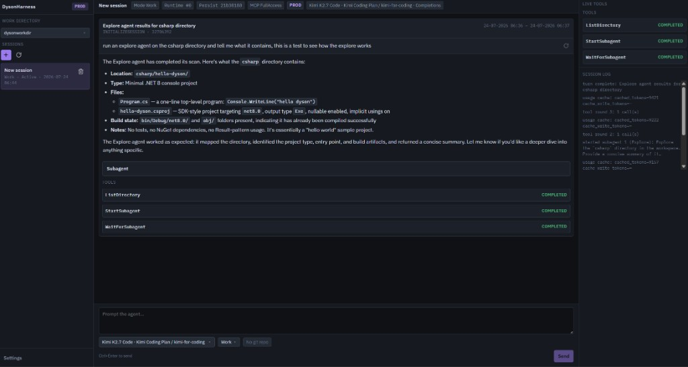

# DysonHarness

DysonHarness is an app for working on a software project with AI. You talk to one **agent** — a conversation with a model that can read the project and act on it. That agent can send other agents to look through the code, write a plan, make the change, and review it. You stay in the conversation. From [EntitySystems](https://github.com/EntitySystems).

Website: [dysonharness.com](https://dysonharness.com/)

> **Early development.** This project is still in early production and is **not even in beta**. Expect change, rough edges, and unfinished parts.



## Meta Agent mode

This is the main way to use DysonHarness. It has its own page. It is not a mode you pick inside an ordinary chat.

You have one Meta Agent conversation per **work directory** — the folder the app treats as the project. You type to it. On the Windows app you can also speak. You do not manage a crowd of chats. Other agents run in the background, and what they finish comes back to this same conversation.

What you see there is written for a person: a short update, a question when a choice is yours, and buttons to open a plan, a file, or a web link. The steps, the tool calls, and the reasoning stay out of this view. **Open full session** shows the same conversation with that detail on. **Tasks** lists what the agent is tracking. Live cards beside the chat show the agents it has sent, including agents those agents sent. You can browse the project's files from the same page. You can stop the whole run.

The Meta Agent sends the work out. It does not edit the project itself.

- **Plans.** It can send an agent to study the project and write a plan. A **plan** is a written design of a change, kept with that project, not a loose note in the chat. Plans sit in a column next to the conversation. Open one to read it or leave a comment. **Build** asks the Meta Agent to carry the plan out. The app does not start that work by itself.
- **Builds.** The agent that changes files works in its own copy of the project, so it does not edit the copy you have open. When it finishes, that copy is merged back. If the two copies disagree, the merge stops and that agent is marked failed. The Meta Agent can then send another agent to sort the conflict out. A change is usually one agent that owns the whole job. Separate agents run side by side only when they do not touch the same files. At most three of those copies run at once.
- **Reviews.** It can send an agent to look for bugs, or one to look for security problems. Those reviews report what they find. They do not change the project.

You can switch work directories without leaving the app. Each one keeps its own Meta Agent conversation, its own plans, and its own agents. The Meta Agent can switch the active project only when that project is the one on screen. If you are looking at another project, it asks you to change directories instead of switching out from under you.

Long Meta Agent conversations are trimmed so they stay within a fixed size.

## The results stay technical

It is easy, with AI, to receive code you cannot read and a summary that hides the real change. DysonHarness is for the opposite. The point is that you can still understand the project and own it.

This README is plain language. The product's results are not dumbed down.

A plan names the real parts of the project, the real change, and why. A build is a concrete edit to those parts, not a paraphrase of what might be done. A review talks about the actual problem it found. When the Meta Agent speaks, or posts a short update, that line is the plain version. The precise version is in the plan, in the files, and in the full session: names, steps, and reasons, specific enough that you can follow them and disagree.

The agents read the codebase you pointed them at. They are not asked to invent a simpler project, or to replace your code with something you are not meant to look at.

## Sessions and work directories

The home screen is an ordinary session: one conversation, one project. You choose how that conversation behaves. **Ask** is for questions. **Plan** is for designing a change before anyone edits. **Work** is for doing the change. From there, the agent can send an **Explore** agent to research and a **Drone** to implement. Their reports come back into the same conversation. You can keep several sessions for one project and resume them later.

Switching the work directory switches the project. The session list is for the project you have open.

An ordinary Plan-mode plan is built from that session. Meta Agent plans are separate: they belong to the project and are built from the Meta Agent page.

You can preview an agent plugin package (Agent Plugin, Codex, or Cursor) and install it only after you accept what it is allowed to do. Nothing in that package runs during the preview.

## Models

Models are set under **Settings → Models**. DysonHarness talks to OpenAI-compatible providers. A demo provider is there for trying the screens with no account.

It is built for capable models. A smaller model can lose track once several agents are working at once. Limiting which tools a mode may use helps a little. It is not a fix.

Models this project has been used with:

- GLM 5.2 and GLM 4.7
- Kimi K2.7 Code and Kimi K3
- GPT 5.6 Luna/Terra and GPT 5.6 Sol
- Claude Sonnet 5, Claude Opus 5, and Claude Fable 5.1
- Grok 4.6, with native xAI sign-in under Settings → Models → Grok Build (xAI)

On the Meta Agent page you pick the model, and how hard it should think, for that conversation. You do not set how much of the conversation it keeps. That limit is fixed.

## Voice

Voice belongs to Meta Agent, and only in the Windows app. Set it up under **Settings → Voice**: a speech-to-text model, a text-to-speech model, and the ways your agent's name might be heard.

Turn voice on, say the agent's name, then talk. A short pause sends what you said. While it is speaking, say the name again to interrupt. The words after the name become your next message. Voice stays on as you move between projects, sessions, and Settings, until you turn it off or quit. It does not stay on after a restart.

What you hear is one short sentence in plain English. The written message next to it keeps the names and the detail. If that message is about a project that is not on screen, the spoken line says which project it is from.

The message box also has push-to-talk (hold the button, or Ctrl+M). That types a transcript into the box. It stays off while voice mode is on, so both microphones are not listening.

## The agent browser

On the Windows app, an agent can open its own browser window: open a page, click, type, and read what is there. That window is not your everyday browser. The Linux and macOS apps do not include it.

An agent can also search the public web and read a page without opening that window. That works wherever the app runs.

## Reviews

The bug review and the security review described above report findings. They do not edit the project.

An ordinary session can also run a bug review when it finishes a task it has been tracking. You turn that on in settings, and you choose whether it only reports or also fixes what it confirms. The reviewer still does not edit. If a fix was requested, the session that owns the task does the fix and checks it.

## For people who work on DysonHarness

The app is .NET 10. From a clone of this repo:

**Windows desktop app:**

```bash
dotnet run --project src/Harness/DysonHarness.UI.Windows
```

**Browser app (any platform):**

```bash
dotnet run --project src/Harness/Harness.UI --urls http://localhost:5180
```

Open the app, then **Settings → Models**.

**Downloads:** self-contained builds for Windows, Linux, and macOS are on [GitHub Releases](https://github.com/EntitySystems/DysonHarness/releases). On Windows, use the MSI installer or the zip (`DysonHarness.exe`). Details: [releases](docs/packaging/releases.md).

A terminal client for the same engine, without the graphical app, is planned and not built.

Contributor and agent notes: [AGENTS.md](AGENTS.md).

Docs, if you need the precise behavior:

- [Engine](docs/engine/README.md)
- [Meta Agent mode](docs/engine/meta-agent.md)
- [Plans](docs/storage/plans.md)
- [Sessions](docs/storage/sessions.md)
- [Work directories](docs/storage/work-directories.md)
- [Model profiles](docs/storage/models.md)
- [UI](docs/ui/README.md)
- [Inference providers](docs/inference-providers/README.md)
- [Releases](docs/packaging/releases.md) and [Windows packaging](docs/packaging/webview.md)

## License

Copyright (C) 2026 EntitySystems. Licensed under [AGPL-3.0](LICENSE). Third-party notices, including the MIT-licensed CLIProxyAPI port behind the native xAI provider: [THIRD-PARTY-NOTICES.md](THIRD-PARTY-NOTICES.md).
